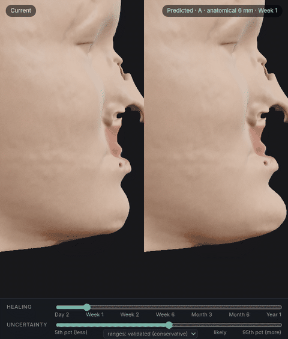
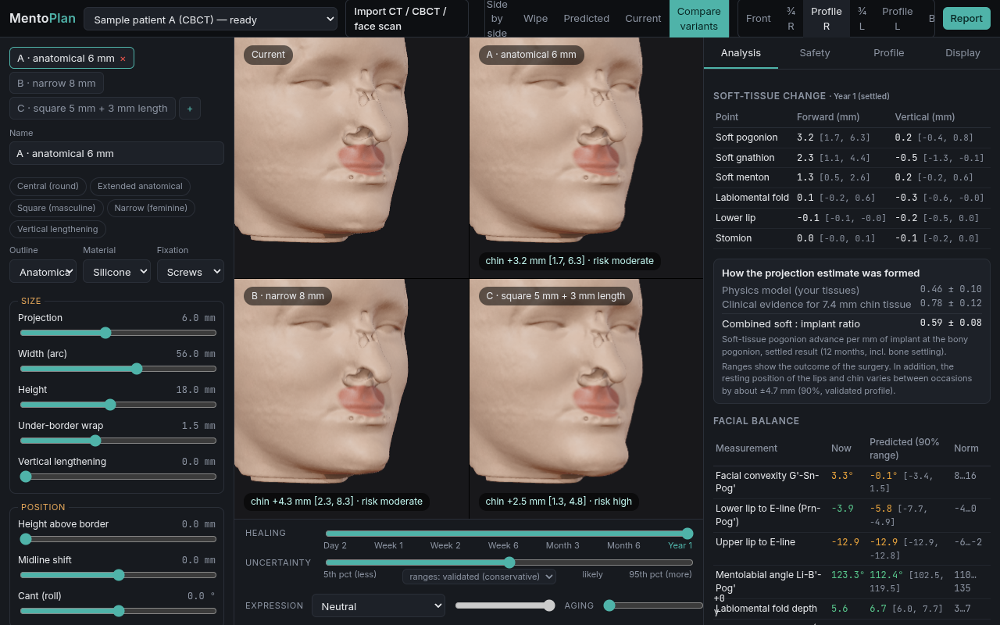
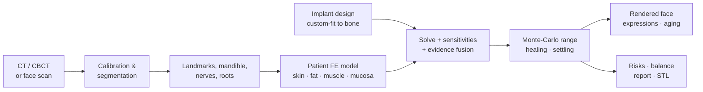

<h1 align="center">MentoPlan</h1>

<p align="center">
  <b>Do the chin implant surgery virtually first.</b><br>
  Open-source, patient-specific planning of custom chin implants from CT/CBCT or a 3D face scan,
  with physics-based prediction of the face after surgery and an honest range of uncertainty.
</p>

<p align="center">
  <a href="https://github.com/debarch777/mentoplan/actions/workflows/ci.yml"></a>
  <a href="LICENSE"></a>
  
  
</p>

<p align="center">
  
</p>

> [!IMPORTANT]
> MentoPlan is **research software, not a medical device**. It has not been cleared by any regulator and
> its accuracy on real chin-implant outcomes has not yet been validated (see [Accuracy](#accuracy)).
> It is a planning and communication aid; it does not replace a surgeon's judgement.

---

## Why

Chin augmentation is a common facial procedure, yet patients often decide from 2-D photo morphs that ignore their own anatomy, and the result is shown as one confident picture. Real
outcomes depend on how thick and stiff *this person's* soft tissue is, how the lips and mentalis
respond, swelling and healing, bone settling under the implant, and where the nerves are.

MentoPlan builds a biomechanical model of the individual lower face from their own scan, lets you
design the implant on their own bone, and shows the predicted face **as a range, not a promise**.

## Features

| | |
|---|---|
| 🩻 **Your own 3D data** | DICOM (folder/zip), NRRD, NIfTI, GIPL, MetaImage; textured OBJ / PLY / STL face scans. Automatic CBCT calibration and non-uniformity correction. A face scan alone also works (anatomy estimated from a template). |
| 🦴 **Automatic anatomy** | Skin, bone, teeth, mandible, mid-sagittal plane, 20+ cephalometric landmarks, mental foramina (nerve exits), tooth roots, with confidence notes. Chin rests and parts outside the scan field of view are detected and handled. |
| ✏️ **Custom implant design** | Projection, width, height, position, vertical lengthening, under-border wrap, shape (central / anatomical / square), wings, asymmetry, midline shift, cant, edge feathering; silicone, porous polyethylene, PEEK, titanium. Custom-fit to the bone; STL export. Multiple variants. |
| 🧮 **Physics, not morphing** | Boundary-fitted finite-element model of skin, fat, muscle and mucosa; implant pocket in which tissue slides; lips that slide over the teeth and part at the mouth; optional large-deformation (neo-Hookean) solution. |
| 📚 **Evidence-calibrated** | Patient-specific physics fused with published soft-to-implant ratios for the measured chin-pad thickness; the app shows how each estimate was formed. |
| 📏 **Honest uncertainty** | Tissue properties, adhesion, surgical placement error, bone settling, swelling and a model-error term calibrated on a real surgical outcome. 90% ranges for every point and measurement, and a slider that morphs between the 5th and 95th percentile face. |
| ⏳ **Healing timeline** | Day 2, week 1, 2, 6, months 3, 6 and the settled result at one year. |
| 😊 **Expressions and aging** | Smile, broad smile, mouth open, pucker, chin raise, frown (muscle-driven) and +0–20 years of aging, on the current face and on every variant. |
| ⚖️ **Whole-face balance** | Convexity, E-line, mentolabial angle, labiomental fold, Z-angle, lower-third proportions, chin width and midline, now and planned. |
| ⚠️ **Risk checks** | Mental nerve clearance, tooth roots and screws, bone pressure and resorption, migration, skin tension, palpability, lip competence, over-projection. |
| 🎨 **Realistic rendering** | Physically based skin (subsurface scattering approximation, pores, sebum, vellus sheen), photo texture from a face scan, HDR studio lighting with soft shadows, ambient occlusion. Side-by-side, wipe, and compare up to three designs with one shared camera. |
| 📄 **Report** | Printable report with images, measurements, ranges, risks and limitations. |

<p align="center">
  
</p>

## How it works



Methods are documented in [`docs/model.md`](docs/model.md), priors and sources in
[`docs/evidence.md`](docs/evidence.md).

## Quick start

Requirements: Linux (tested; macOS and Windows/WSL untested), Python ≥ 3.11, Node ≥ 18, about 8 GB RAM.

```bash
git clone https://github.com/debarch777/mentoplan.git && cd mentoplan
python3 -m venv .venv && .venv/bin/pip install -e "backend[dev]"
(cd frontend && npm ci && npx vite build)

scripts/setup_samples.sh     # optional: two public sample CBCTs as demo cases (~6 min)
scripts/server.sh start      # open http://127.0.0.1:8000
```

Your own scan:

```bash
.venv/bin/mentoplan ingest path/to/ct_or_cbct --name "Patient"                  # CT/CBCT
.venv/bin/mentoplan ingest path/to/ct --surface face.obj --name "Patient"       # + textured face scan
.venv/bin/mentoplan ingest --surface face.obj --name "Patient (scan only)"      # face scan only
```

or use **Import** in the app. Processing takes 2–5 minutes. Then read the
[user guide](docs/user-guide.md).

**Resources.** Heavy steps run one at a time in separate processes with a hard memory limit and
refuse to start when less than ~3.5 GB is free, so a large scan fails with a message instead of
freezing the computer. Math libraries use 4 threads (`OMP_NUM_THREADS` overrides).

## Accuracy

Everything here is reproducible; details in [`docs/validation.md`](docs/validation.md).

| Test | Result |
|---|---|
| Finite-element verification (patch test on distorted elements, consistent tangent, analytic neo-Hookean stretch, no volumetric locking) | passes (`backend/tests/test_hexfem.py`) |
| Real surgical outcome: pre/post jaw-surgery CBCT pair, face predicted from the measured bone movements only | **2.2 mm** mean absolute error (RMS 2.8 mm) vs 3.7 mm for "no change"; **91%** of the real surface inside the stated 90% range |
| Face-scan-only planning vs. CT of the same person | soft-tissue landmarks 3.0 mm RMS; bony chin 3.8 mm |

**Where this stands honestly.** Published results for commercial planning software are 1.2–1.8 mm RMS
(Knoops et al., 2019, maxillary surgery, 7 patients). MentoPlan has been validated on **one**
surgical case, which was jaw surgery, not a chin implant, so parity is **not demonstrated**.
No public pre/post chin-implant dataset exists. If you have one, see
[Contributing](CONTRIBUTING.md#most-valuable-contribution-outcome-data): `mentoplan validate-ortho`
measures accuracy on any pre/post pair unchanged.

## Roadmap

- [ ] Multi-patient chin-implant validation (help wanted: de-identified pre/post data)
- [ ] Interactive segmentation correction (bone, skin, nerves)
- [ ] Manufacturability checks for the implant STL (wall thickness, printability)
- [ ] GPU solver for faster nonlinear refinement
- [ ] Genioplasty (sliding osteotomy) planning on the same model
- [ ] Docker image and one-click installers

## Project layout

```
backend/mentoplan/
  io/          volume and mesh I/O, STL export
  imaging/     calibration, CBCT correction, segmentation, surfaces
  anatomy/     head frame, landmarks, mandible separation, nerves, roots
  implant/     parametric thickness field, custom-fit solid, arch coordinates
  tissue/      hexahedral FE, patient model, solvers, probabilistic prediction, expressions, aging
  analysis/    cephalometry, risk assessment
  validation/  retrospective pre/post validation
  api/         FastAPI server and binary mesh bundles
frontend/src/
  viewer/      three.js renderer, skin shader, lighting, deformation composition
  components/  viewport, design panel, analysis, variant comparison
```

## Contributing

Issues and pull requests are welcome; see [CONTRIBUTING.md](CONTRIBUTING.md). Outcome data for
validation is the single most valuable contribution. Please never post identifiable patient data.

## Citation

If you use MentoPlan in research, please cite it (GitHub's "Cite this repository" button uses
[CITATION.cff](CITATION.cff)).

## Acknowledgements

Development and validation scans: [3D Slicer](https://www.slicer.org/) sample data
(PreDentalSurgery / PostDentalSurgery, DZ-CBCT), downloaded by `scripts/get_sample_data.sh`.
Built with NumPy, SciPy, scikit-image, trimesh, pypardiso, FastAPI, React and three.js.

## License

[MIT](LICENSE). Research use only; see the medical disclaimer in the license file.
